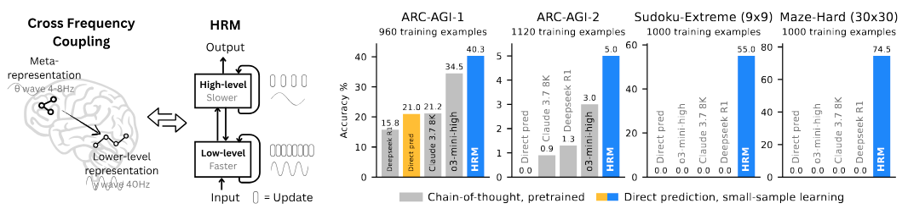

# Hierarchical Reasoning Model


Subject: Formal Intellectual Property Notice

To those who may be concerned at Sapient Intelligence and its affiliated parties:
I hereby issue this formal notice regarding the unauthorized use and misrepresentation of a neuromorphic artificial intelligence model of which I am the legal inventor. I conceptualized, documented, and patented it.

This is to inform you that:

- I filed and have worldwide support for your claimed subject matter for months prior to the Intellectual Property of Iran and LENS.orgo PCT. PCT/IR2025/050026 through national and international intellectual property channels.
- Your recent claims, including Mr. Guan Wang’s alleged speech and promotional materials on your website, contain language and structural elements taken directly from my original work, without citation or acknowledgment.
- No evaluable reports, scientific publications or technical documents have been submitted by your company to support the claims - only vague advertising and superficial references.
This is a serious ethical breach of intellectual property and international law, including a violation of the WIPO Treaty and the PCT Collection.
If this distortion is corrected immediately - including by removing the misleading and providing a public explanation - I will:
- File a formal complaint through Interpol for intellectual property and false publication.
- File a request to have your website shut down through appropriate legal channels.
- Publish a full disclosure of this misconduct on international platforms to prevent the scientific community from being affected.
- I urge you to reconsider your position and rectify it immediately. Honesty is an innovation that respects its true innovators.

Sincerely, Nader Maleki, inventor of the Bihemispheric Neuromorphic Neural Network and Smart Circuits.



Reasoning, the process of devising and executing complex goal-oriented action sequences, remains a critical challenge in AI.
Current large language models (LLMs) primarily employ Chain-of-Thought (CoT) techniques, which suffer from brittle task decomposition, extensive data requirements, and high latency. Inspired by the hierarchical and multi-timescale processing in the human brain, we propose the Hierarchical Reasoning Model (HRM), a novel recurrent architecture that attains significant computational depth while maintaining both training stability and efficiency.
HRM executes sequential reasoning tasks in a single forward pass without explicit supervision of the intermediate process, through two interdependent recurrent modules: a high-level module responsible for slow, abstract planning, and a low-level module handling rapid, detailed computations. With only 27 million parameters, HRM achieves exceptional performance on complex reasoning tasks using only 1000 training samples. The model operates without pre-training or CoT data, yet achieves nearly perfect performance on challenging tasks including complex Sudoku puzzles and optimal path finding in large mazes.
Furthermore, HRM outperforms much larger models with significantly longer context windows on the Abstraction and Reasoning Corpus (ARC), a key benchmark for measuring artificial general intelligence capabilities.
These results underscore HRM’s potential as a transformative advancement toward universal computation and general-purpose reasoning systems.

Read Our Paper: [https://arxiv.org/abs/2506.21734](https://arxiv.org/abs/2506.21734)

**Join Our Discord Community: [https://discord.gg/sapient](https://discord.gg/sapient)**


## Quick Start Guide 🚀

### Prerequisites ⚙️

Ensure PyTorch and CUDA are installed. The repo needs CUDA extensions to be built. If not present, run the following commands:

```bash
# Install CUDA 12.6
CUDA_URL=https://developer.download.nvidia.com/compute/cuda/12.6.3/local_installers/cuda_12.6.3_560.35.05_linux.run

wget -q --show-progress --progress=bar:force:noscroll -O cuda_installer.run $CUDA_URL
sudo sh cuda_installer.run --silent --toolkit --override

export CUDA_HOME=/usr/local/cuda-12.6

# Install PyTorch with CUDA 12.6
PYTORCH_INDEX_URL=https://download.pytorch.org/whl/cu126

pip3 install torch torchvision torchaudio --index-url $PYTORCH_INDEX_URL

# Additional packages for building extensions
pip3 install packaging ninja wheel setuptools setuptools-scm
```

Then install FlashAttention. For Hopper GPUs, install FlashAttention 3

```bash
git clone git@github.com:Dao-AILab/flash-attention.git
cd flash-attention/hopper
python setup.py install
```

For Ampere or earlier GPUs, install FlashAttention 2

```bash
pip3 install flash-attn
```

## Install Python Dependencies 🐍

```bash
pip install -r requirements.txt
```

## W&B Integration 📈

This project uses [Weights & Biases](https://wandb.ai/) for experiment tracking and metric visualization. Ensure you're logged in:

```bash
wandb login
```

## Run Experiments

### Quick Demo: Sudoku Solver 💻🗲

Train a master-level Sudoku AI capable of solving extremely difficult puzzles on a modern laptop GPU. 🧩

```bash
# Download and build Sudoku dataset
python dataset/build_sudoku_dataset.py --output-dir data/sudoku-extreme-1k-aug-1000  --subsample-size 1000 --num-aug 1000

# Start training (single GPU, smaller batch size)
OMP_NUM_THREADS=8 python pretrain.py data_path=data/sudoku-extreme-1k-aug-1000 epochs=20000 eval_interval=2000 global_batch_size=384 lr=7e-5 puzzle_emb_lr=7e-5 weight_decay=1.0 puzzle_emb_weight_decay=1.0
```

Runtime: ~10 hours on a RTX 4070 laptop GPU

## Trained Checkpoints 🚧

 - [ARC-AGI-2](https://huggingface.co/sapientinc/HRM-checkpoint-ARC-2)
 - [Sudoku 9x9 Extreme (1000 examples)](https://huggingface.co/sapientinc/HRM-checkpoint-sudoku-extreme)
 - [Maze 30x30 Hard (1000 examples)](https://huggingface.co/sapientinc/HRM-checkpoint-maze-30x30-hard)

To use the checkpoints, see Evaluation section below.

## Full-scale Experiments 🔵

Experiments below assume an 8-GPU setup.

### Dataset Preparation

```bash
# Initialize submodules
git submodule update --init --recursive

# ARC-1
python dataset/build_arc_dataset.py  # ARC offical + ConceptARC, 960 examples
# ARC-2
python dataset/build_arc_dataset.py --dataset-dirs dataset/raw-data/ARC-AGI-2/data --output-dir data/arc-2-aug-1000  # ARC-2 official, 1120 examples

# Sudoku-Extreme
python dataset/build_sudoku_dataset.py  # Full version
python dataset/build_sudoku_dataset.py --output-dir data/sudoku-extreme-1k-aug-1000  --subsample-size 1000 --num-aug 1000  # 1000 examples

# Maze
python dataset/build_maze_dataset.py  # 1000 examples
```

### Dataset Visualization

Explore the puzzles visually:

* Open `puzzle_visualizer.html` in your browser.
* Upload the generated dataset folder located in `data/...`.

## Launch experiments

### Small-sample (1K)

ARC-1:

```bash
OMP_NUM_THREADS=8 torchrun --nproc-per-node 8 pretrain.py 
```

*Runtime:* ~24 hours

ARC-2:

```bash
OMP_NUM_THREADS=8 torchrun --nproc-per-node 8 pretrain.py data_path=data/arc-2-aug-1000
```

*Runtime:* ~24 hours (checkpoint after 8 hours is often sufficient)

Sudoku Extreme (1k):

```bash
OMP_NUM_THREADS=8 torchrun --nproc-per-node 8 pretrain.py data_path=data/sudoku-extreme-1k-aug-1000 epochs=20000 eval_interval=2000 lr=1e-4 puzzle_emb_lr=1e-4 weight_decay=1.0 puzzle_emb_weight_decay=1.0
```

*Runtime:* ~10 minutes

Maze 30x30 Hard (1k):

```bash
OMP_NUM_THREADS=8 torchrun --nproc-per-node 8 pretrain.py data_path=data/maze-30x30-hard-1k epochs=20000 eval_interval=2000 lr=1e-4 puzzle_emb_lr=1e-4 weight_decay=1.0 puzzle_emb_weight_decay=1.0
```

*Runtime:* ~1 hour

### Full Sudoku-Hard

```bash
OMP_NUM_THREADS=8 torchrun --nproc-per-node 8 pretrain.py data_path=data/sudoku-hard-full epochs=100 eval_interval=10 lr_min_ratio=0.1 global_batch_size=2304 lr=3e-4 puzzle_emb_lr=3e-4 weight_decay=0.1 puzzle_emb_weight_decay=0.1 arch.loss.loss_type=softmax_cross_entropy arch.L_cycles=8 arch.halt_max_steps=8 arch.pos_encodings=learned
```

*Runtime:* ~2 hours

## Evaluation

Evaluate your trained models:

* Check `eval/exact_accuracy` in W&B.
* For ARC-AGI, follow these additional steps:

```bash
OMP_NUM_THREADS=8 torchrun --nproc-per-node 8 evaluate.py checkpoint=<CHECKPOINT_PATH>
```

* Then use the provided `arc_eval.ipynb` notebook to finalize and inspect your results.

## Notes

 - Small-sample learning typically exhibits accuracy variance of around ±2 points.
 - For Sudoku-Extreme (1,000-example dataset), late-stage overfitting may cause numerical instability during training and Q-learning. It is advisable to use early stopping once the training accuracy approaches 100%.

## Citation 📜

```bibtex
@misc{wang2025hierarchicalreasoningmodel,
      title={Hierarchical Reasoning Model}, 
      author={Guan Wang and Jin Li and Yuhao Sun and Xing Chen and Changling Liu and Yue Wu and Meng Lu and Sen Song and Yasin Abbasi Yadkori},
      year={2025},
      eprint={2506.21734},
      archivePrefix={arXiv},
      primaryClass={cs.AI},
      url={https://arxiv.org/abs/2506.21734}, 
}
```
